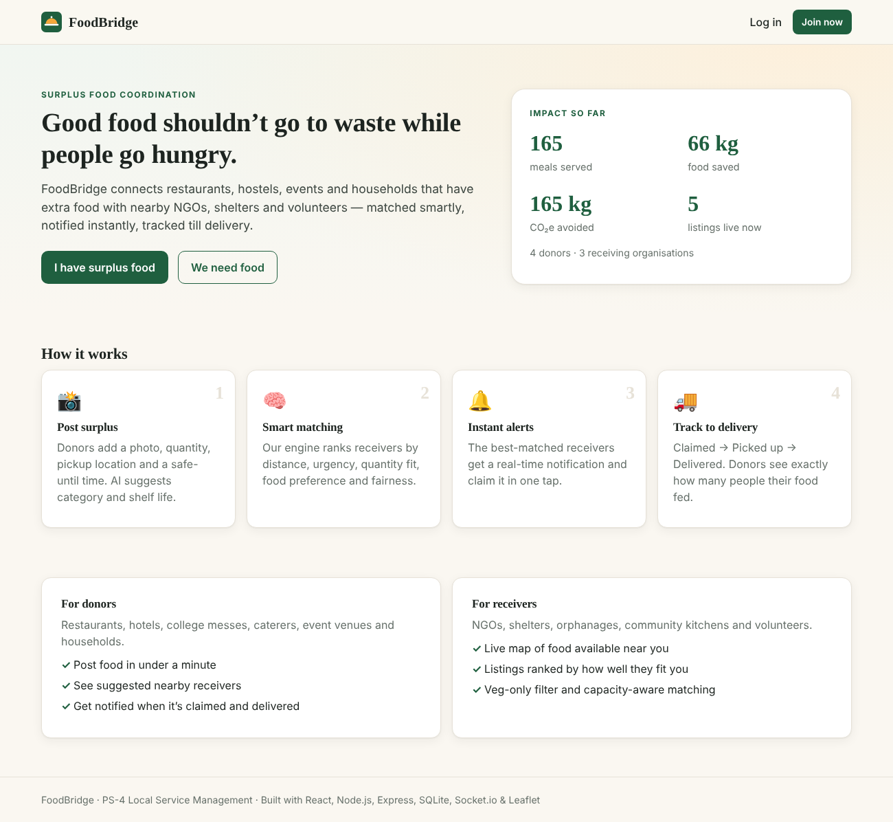
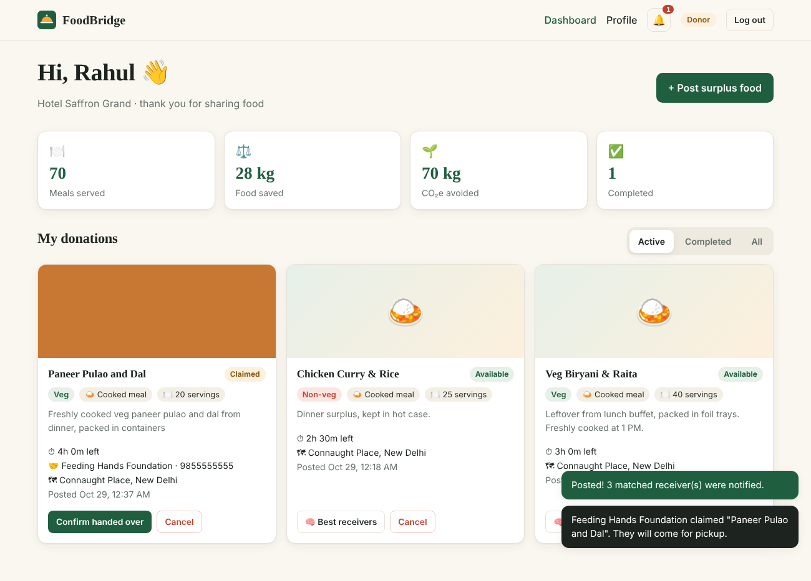
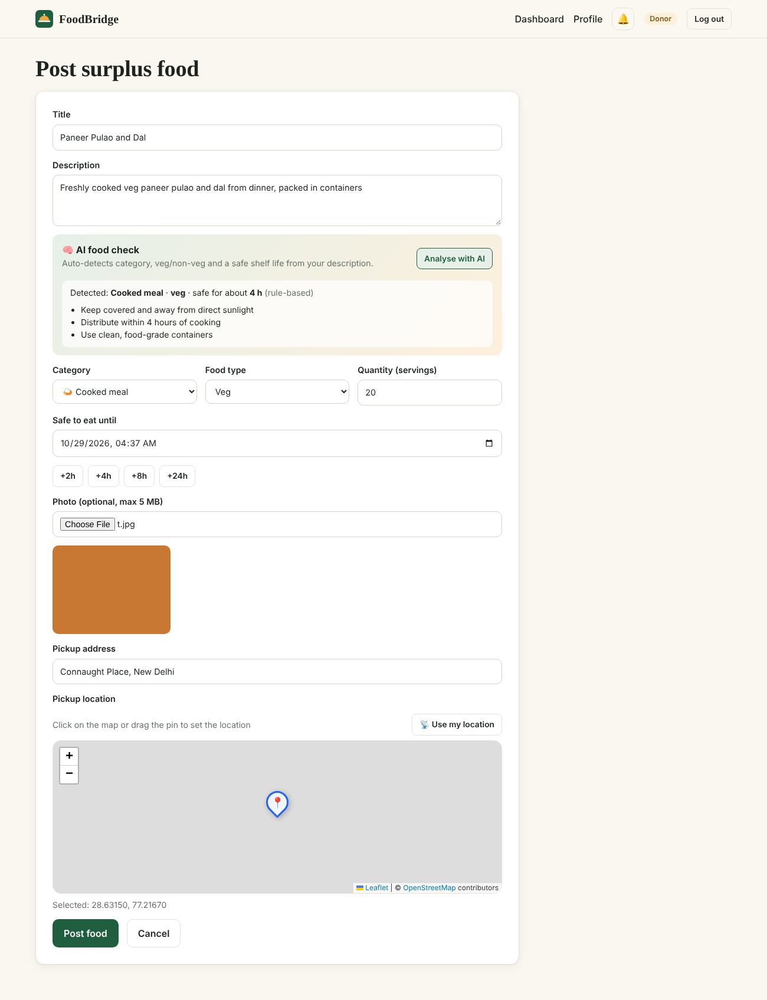
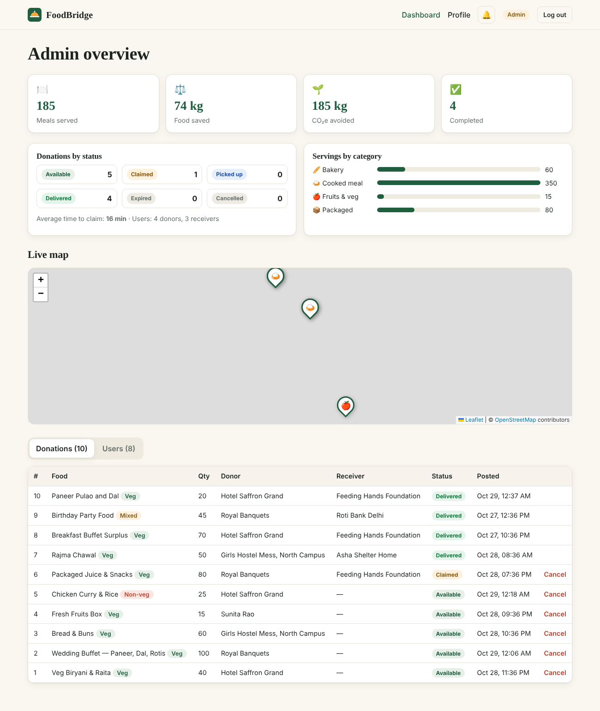

# 🍱 FoodBridge — Surplus Food Coordination System

> **PS-4 · Local Service Management · 5th Semester**
> *Restaurants, hostels, events, and households may have surplus food while nearby people or organizations need food. Develop a system that helps coordinate the collection and distribution of usable surplus food.*

FoodBridge connects **donors** (restaurants, hostels, caterers, event venues, households) who have extra food with **receivers** (NGOs, shelters, community kitchens, volunteers) nearby. Food is posted with a photo and a "safe until" time, matched to the best receivers by a smart scoring engine, announced through **real-time notifications**, shown on a **live map**, and tracked from **claim → pickup → delivery**.

### 👥 Team CodeBlooded (Team 5)

| Name | Enrollment No. |
|---|---|
| Yash Chopade | BTE24FSD100019 |
| Priyambada Chouhan | BTE24FSD000011 |
| Mohammad Ayan Manihar | — |

**Mentor:** Verman Kumar, IIT (BHU) Varanasi

---

## 🎥 Demo Video

**▶️ Demo video: [docs/FoodBridge_Demo.mp4](docs/FoodBridge_Demo.mp4)** (about 3 minutes, captioned walkthrough of every feature)

## 📊 Presentation

The project presentation is in [`docs/FoodBridge_PS4_Presentation.pptx`](docs/FoodBridge_PS4_Presentation.pptx).

---

## ✨ Features

| Focus area | How FoodBridge covers it |
|---|---|
| **Middleware** | JWT authentication, role-based access control (donor / receiver / admin), request logging, input validation, rate limiting on login/register, upload filtering, central error handler |
| **Database** | SQLite (via `sql.js`) with 3 related tables — `users`, `donations`, `notifications` — with foreign keys, CHECK constraints and indexes |
| **Image upload** | Donors attach a food photo (JPG/PNG/WEBP, max 5 MB) using Multer; images are stored on the server and shown on cards |
| **Real-time notifications** | Socket.io pushes instant alerts: new matching food, claimed, picked up, delivered, cancelled, expired. Dashboards refresh live, and a notification bell keeps history |
| **Maps** | Leaflet + OpenStreetMap (no API key needed): live map of nearby food, location picker with GPS, 15 km match radius, one-tap Google Maps directions |
| **AI-based matching** | A weighted scoring engine ranks donations for each receiver (and receivers for each donation) with an explanation of *why* it matched |
| **AI food check** | Analyzes the food description to suggest category, veg/non-veg and a safe shelf life with handling tips — uses Google Gemini if an API key is set, otherwise a built-in rule-based model |

Other features include:
- An **impact dashboard** showing meals served, kg of food saved and CO₂ avoided
- **Automatic expiry**: a background job expires food after its safe time and notifies the donor
- **Race-safe claiming**: two receivers can't claim the same food, because the claim is an atomic SQL update
- A **veg-only filter** and **capacity-aware** matching
- An **admin panel** with stats, a live map, and all users and donations
- A responsive UI that works on mobile

### 🧠 How smart matching works

For each donation and receiver pair, a score from 0 to 100 is calculated:

| Factor | Weight | Logic |
|---|---|---|
| Distance | 35% | Haversine distance; closer is better (0 at 15 km) |
| Urgency | 25% | Food expiring within 2 h gets top priority |
| Quantity fit | 20% | How closely the servings match the receiver's capacity |
| Food preference | 10% | Veg-only receivers never see non-veg food (hard filter) |
| Fairness | 10% | Receivers with fewer pending pickups get a boost, so food is shared fairly |

When food is posted, the **top 5 matches (score ≥ 35%) inside the radius are notified instantly**. Receivers see listings sorted by their personal match score along with the reasons for it (e.g. *"Very close (1.5 km)"*, *"Expires within 2 hours — urgent"*). Donors can click **"Best receivers"** to see who suits their food best.

### 🔄 Donation lifecycle

```
available ──claim──▶ claimed ──pickup──▶ picked_up ──deliver──▶ delivered
    │                   │
    │                   ├──unclaim──▶ available
    └──cancel / expire──┴──▶ cancelled / expired
```

---

## 🛠 Tech Stack

- **Frontend:** React 19, Vite, React Router, Leaflet / React-Leaflet, Socket.io client
- **Backend:** Node.js, Express 5, Socket.io, Multer, JSON Web Tokens, bcryptjs
- **Database:** SQLite (`sql.js`, pure WebAssembly — no native build or DB server to install)
- **AI:** Weighted matching engine and Google Gemini API (optional), with a rule-based fallback

## 📁 Project Structure

```
foodbridge/
├── client/                 # React frontend (Vite)
│   └── src/
│       ├── components/     # Layout, Maps, DonationCard, StatTiles
│       ├── lib/            # api client, auth + socket context, formatters
│       └── pages/          # Landing, Auth, Donor/Receiver/Admin dashboards, PostFood, Profile
├── server/                 # Express backend
│   └── src/
│       ├── middleware/     # auth (JWT + roles), upload (multer), common (logger, validation, rate-limit, errors)
│       ├── routes/         # auth, donations, notifications, stats, admin, ai
│       ├── services/       # matching engine, food analyzer (AI), real-time notifier
│       ├── db.js           # SQLite schema + helpers
│       ├── seed.js         # demo data
│       └── index.js        # server entry (Express + Socket.io + expiry job)
└── docs/                   # presentation, screenshots, demo script
```

---

## 🚀 Getting Started

**Requirements:** [Node.js 18+](https://nodejs.org) (LTS recommended)

```bash
git clone <your-repo-url>
cd foodbridge
npm run setup      # installs server + client dependencies and loads demo data
npm start          # builds the frontend and starts everything on http://localhost:5000
```

Open **http://localhost:5000**.

### Development mode (hot reload)

Run these in two terminals:

```bash
npm run server     # API on http://localhost:5000
npm run client     # React on http://localhost:5173 (proxies /api to :5000)
```

### Demo accounts

| Role | Email | Password |
|---|---|---|
| Donor (hotel) | hotel@demo.com | demo123 |
| Donor (hostel / event / household) | hostel@demo.com · events@demo.com · home@demo.com | demo123 |
| Receiver (NGO) | ngo@demo.com | demo123 |
| Receiver (veg-only shelter) | shelter@demo.com | demo123 |
| Receiver (community kitchen) | rotibank@demo.com | demo123 |
| Admin | admin@foodbridge.in | admin123 |

The login page also has one-click buttons that fill these in. Run `npm run seed` at any time to reset the demo data.

### Optional configuration

Copy `server/.env.example` to `server/.env` to change these settings:

```env
PORT=5000
JWT_SECRET=change-this-to-a-long-random-string
MATCH_RADIUS_KM=15
GEMINI_API_KEY=        # optional: enables Gemini-powered AI food check
```

---

## 🔌 REST API

All endpoints are under `/api`. Protected routes need the header `Authorization: Bearer <token>`.

| Method | Endpoint | Access | Description |
|---|---|---|---|
| POST | `/auth/register` | public | Create a donor or receiver account |
| POST | `/auth/login` | public | Log in and get a JWT |
| GET / PUT | `/auth/me` | user | Get or update the profile, location and preferences |
| GET | `/donations` | user | Available food (ranked by match score for receivers; `?sort=distance\|expiry`) |
| GET | `/donations/mine` | user | Donor: food I posted · Receiver: food I claimed |
| GET | `/donations/:id` | user | Details (plus suggested receivers for the owner) |
| POST | `/donations` | donor | Post food (multipart with `image`) and notify matches |
| POST | `/donations/:id/claim` | receiver | Claim food (atomic) |
| POST | `/donations/:id/unclaim` | receiver | Release a claim |
| POST | `/donations/:id/pickup` | donor / claimer | Confirm pickup |
| POST | `/donations/:id/deliver` | receiver | Confirm distribution |
| POST | `/donations/:id/cancel` | donor / admin | Cancel a donation |
| GET | `/notifications` | user | Latest notifications and unread count |
| POST | `/notifications/read-all` | user | Mark all as read |
| POST | `/ai/analyze` | user | AI food check on a description |
| GET | `/stats/public` · `/stats/me` | public / user | Impact statistics |
| GET | `/admin/overview` · `/admin/users` · `/admin/donations` | admin | Admin data |

**Socket.io events** (the client connects with `auth: { token }`):
- `notification` — sent to one user
- `donation:update` — broadcast to everyone, so lists and maps refresh

---

## 📸 Screenshots

| Landing | Donor dashboard |
|---|---|
|  |  |
| **Post food with AI check** | **Admin panel** |
|  |  |

---

## 🔮 Future Scope

- A mobile app with push notifications (FCM)
- Volunteer delivery partners with live tracking
- Image-based food recognition and freshness detection
- Food-safety ratings and verified-NGO badges
- Multilingual interface (Hindi and regional languages)

## 📄 License

MIT
